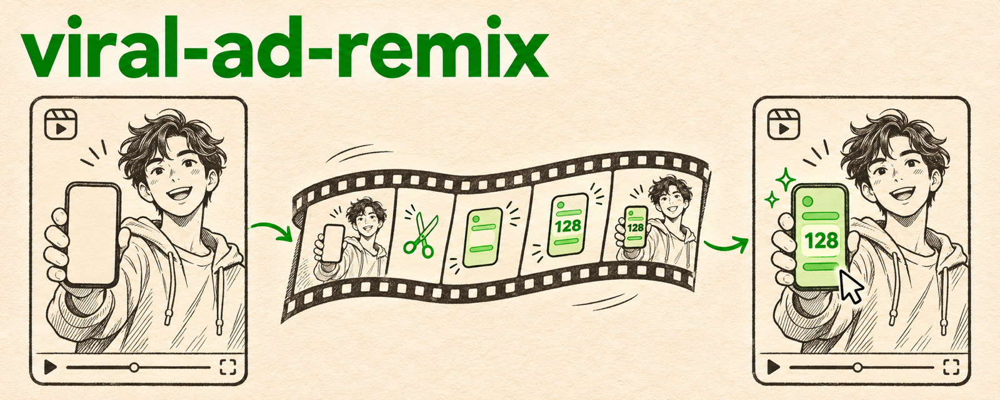

<p align="center">
  
</p>

<p align="center">
  <a href="README.md">English</a> · <b>한국어</b>
</p>

# viral-ad-remix

**이미 터진 광고를 우리 앱 광고로 다시 만들고, 휴대폰 화면은 전부 진짜 앱으로 채웁니다.**

## 무엇인가

[Claude Code](https://claude.com/claude-code)와 [Codex](https://github.com/openai/codex)용 에이전트 스킬입니다. 에이전트가 성과가 검증된 숏폼 광고를 찾아 AI 영상 모델로 우리 인물과 장소에 맞게 다시 만듭니다. 그다음 AI가 틀리게 만든 부분을 바로잡습니다. 화면 속 모든 휴대폰에 실제 앱 녹화를 입히고, 대사는 그 말을 하는 얼굴에 맞춥니다. 말 없는 구간을 잘라 내고, 훅·자막·엔드카드를 붙이고, 결과를 프레임 단위로 검수합니다.

## 왜 만들었나

AI 영상 모델은 광고의 구성은 잘 따라 하지만 세부를 틀립니다. 실제로 리메이크해 보니 문제가 줄줄이 나왔습니다.
- **가짜 휴대폰 화면:** 휴대폰 화면에 다른 앱 디자인을 그렸고, 음성과 다른 금액을 띄웠습니다.
- **손 장면:** 휴대폰을 누르는 손이 뭉개졌습니다.
- **확대:** 휴대폰을 가리려고 확대하자 얼굴이 흐려졌습니다.
- **싱크:** 컷을 다시 붙이자 대사가 엉뚱한 입에 붙었습니다.
- **멈춤:** 정지 프레임 때문에 얼굴이 멈칫했습니다.
- **검수:** 깨끗한 컨텍스트의 검수자에게 "규정에 맞게"만 시키자 인물과 앱 화면을 다 지워 버렸습니다.

이 스킬은 이 실패 하나하나를 작업 단계나 검사 항목으로 바꿔 둔 것입니다.

## 하는 일

| 단계 | 스크립트 | 결과 |
| --- | --- | --- |
| 레퍼런스 찾기 | `find_reference_ads.py` | TikTok Creative Center 상위 광고를 국가·목적(앱 설치)·키워드·언어로 검색, 4~30초 영상 다운로드 |
| AI 결과 파악 | `analyze_source.py` | 장면 전환과 안전한 자르기 범위, 단어 시간이 붙은 대사, 컨택트 시트, 정확한 오디오 컷용 50ms 음량 프로파일 |
| 휴대폰 화면 교체 | `screen_replace.py auto` | 화면을 찾아 베젤에 맞추고, 휴대폰을 장면 끝까지 추적(돌아가는 중에도)해 실제 앱 녹화를 합성. 장면 전환에서 멈추고 검수 이미지를 만듦 |
| 결과 강조 | `pop_highlight.py` | 실제 앱 화면의 핵심 숫자가 튀어나오며 빛나고 반짝임 |
| 텍스트 | `captions.py` | 훅·자막·엔드카드를 PNG로 (ffmpeg `drawtext` 불필요) |
| 조립 | `assemble.py` | 타임라인 JSON으로 완성본 생성. 말하는 얼굴은 같은 원본 시간, 실제 프레임 디졸브, 오버레이, 음악, 길이 검사 |
| 검수 | `verify.py` | 금지 프레임 검사, 얼굴 정지 검사, 음량, 받아쓰기, 컨택트 시트 |

## 예시

실제 리메이크의 두 장면을, 모서리를 손으로 하나도 찍지 않고 처리한 결과입니다. 하나는 역광이라 밝기만으로는 화면을 못 찾던 장면이고, 다른 하나는 휴대폰이 돌아가며 들어오는 데다 잘라 낸 범위가 장면 전환을 넘어간 장면입니다.

```text
$ screen_replace.py auto ai.mp4 3.29 6.54 app.mp4 shotB.mp4 --work wB --app-start 2.4
key frame 24  quad "46,405 154,386 182,638 65,657"
tracked 78 of 78 frames -> wB/quads.json

$ screen_replace.py auto ai.mp4 17.42 21.36 app.mp4 shotE.mp4 --work wE --app-start 10.62 --blank 0,1740,1080,2020
shot cut detected at frame 94: dropped 2 frames after it
key frame 57  quad "76,256 149,265 151,415 76,409"
tracked 94 of 94 frames -> wE/quads.json
```

타임라인 JSON 하나로 15초 광고 전체를 조립하고 검수한 결과입니다.

```text
$ assemble.py timeline.json final.mp4
video 14.840s  audio 14.840s
$ verify.py final.mp4 --forbid ai.mp4:10.75-17.33 --person 0-3.2 --person 5.2-8.8 --sheet sheet.jpg
forbidden ai.mp4:10.75-17.33: 0 frames []
person 0-3.2: frozen runs at none
person 5.2-8.8: frozen runs at none
```

## 필요한 것

- `ffmpeg`가 있는 macOS 또는 Linux
- `numpy`, `pillow`, `opencv-python-headless`가 설치된 Python 3
- 대사 타이밍·검수용(선택): `mlx-whisper`(Apple Silicon) 또는 `openai-whisper`
- 레퍼런스 광고를 리크리에이트할 수 있는 AI 영상 도구(예: "ad recreate"나 video-to-video 모델). 에이전트를 통해 사용
- 앱 화면 녹화([app-demo-recorder](https://github.com/nathankim0/app-demo-recorder) 스킬로 깔끔하게 찍을 수 있음)

## 설치

### Claude Code 플러그인

```
/plugin marketplace add nathankim0/viral-ad-remix
/plugin install viral-ad-remix@viral-ad-remix
```

### Claude Code·Codex 개인 스킬 (심볼릭 링크, `git pull`로 업데이트)

```bash
git clone https://github.com/nathankim0/viral-ad-remix ~/viral-ad-remix
~/viral-ad-remix/install.sh          # or: install.sh claude | install.sh codex
brew install ffmpeg
pip3 install numpy pillow opencv-python-headless mlx-whisper
```

## 사용법

에이전트에게 이렇게 요청하면 됩니다. "한국에서 터진 앱 설치 광고 중 우리 적립금 계산 기능에 맞는 걸 찾아서, 60대 여성이 나오게 우리 앱 광고로 다시 만들어줘." Codex에서는 `$viral-ad-remix`로 부를 수 있습니다. 에이전트는 `SKILL.md`의 순서대로 진행합니다. 레퍼런스 → 생성 지시서 → 장면 분석 → 화면 교체 → 조립 → 검수입니다.

스크립트는 하나씩 따로 실행해도 됩니다. 옵션은 `--help`로 보고, 타임라인 형식은 `assemble.py --help`에 있습니다.

## 저장소 구조

```text
skills/viral-ad-remix/SKILL.md               workflow the agent follows
skills/viral-ad-remix/references/lessons.md  failures the workflow avoids
skills/viral-ad-remix/scripts/               find_reference_ads, analyze_source, screen_replace, pop_highlight, captions, assemble, verify
skills/viral-ad-remix/agents/openai.yaml     Codex display metadata
.claude-plugin/                              plugin and marketplace manifests
install.sh                                   symlink installer for Claude Code and Codex
```

## 라이선스

MIT
