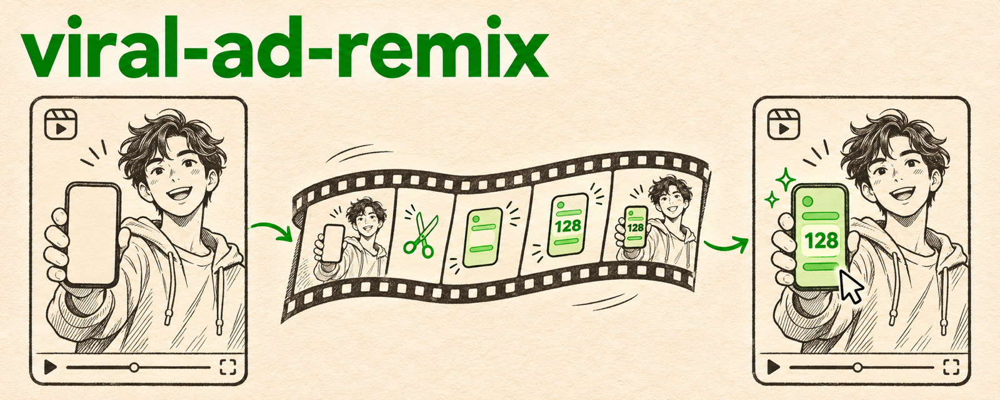

<p align="center">
  
</p>

<p align="center">
  <b>English</b> · <a href="README.ko.md">한국어</a>
</p>

# viral-ad-remix

**Remake an ad that already went viral, for your own app, and keep every phone screen real.**

## What it is

An agent skill for [Claude Code](https://claude.com/claude-code) and [Codex](https://github.com/openai/codex). The agent finds a proven short-form ad, has an AI video model remake it with your cast and setting, and repairs what the model gets wrong. It puts your real app recording onto every phone in the shot, keeps each spoken line on the face that says it, cuts dead air, adds the hook, captions and end card, and checks the result frame by frame.

## Why it exists

AI video models remake an ad's structure well and get the details wrong. In a real remake, the model drew another app's interface on the phone with a different amount than the voice said. Hands typing on the phone came out mangled. Cropping to hide the phone made faces soft and zoomed in. Re-cutting shots put lines on the wrong mouths, and frozen frames made faces stutter. A fresh-context reviewer asked to "make it compliant" deleted the people and the app footage. This skill turns each of those failures into a step or a check.

## What it does

| Step | Script | What you get |
| --- | --- | --- |
| Find references | `find_reference_ads.py` | Top ads from TikTok Creative Center by country, objective (app install), keyword, language; download 4-30 s clips |
| Map the AI output | `analyze_source.py` | Shot cuts with safe trim ranges, spoken lines with word times, a contact sheet, a 50 ms loudness profile for exact audio cuts |
| Fix phone screens | `screen_replace.py auto` | Finds the screen, snaps to the bezel, tracks the phone through the shot (even while it rotates), composites your app recording, stops at shot cuts, writes QA images |
| Show the result | `pop_highlight.py` | The key number on your real app screen pops out, glows and sparkles |
| Text | `captions.py` | Hook, captions and end card as PNGs (no ffmpeg `drawtext` needed) |
| Assemble | `assemble.py` | Timeline JSON to final video: same source times for talking faces, real-frame dissolves, overlays, music, length check |
| Verify | `verify.py` | Forbidden-frame scan, frozen-face scan, loudness, transcript, contact sheet |

## Example

Two shots from a real remake, with no corners entered by hand. In one, a backlit phone where plain brightness detection found nothing. In the other, the phone rotates into view, and the clip range ran past a shot cut:

```text
$ screen_replace.py auto ai.mp4 3.29 6.54 app.mp4 shotB.mp4 --work wB --app-start 2.4
key frame 24  quad "46,405 154,386 182,638 65,657"
tracked 78 of 78 frames -> wB/quads.json

$ screen_replace.py auto ai.mp4 17.42 21.36 app.mp4 shotE.mp4 --work wE --app-start 10.62 --blank 0,1740,1080,2020
shot cut detected at frame 94: dropped 2 frames after it
key frame 57  quad "76,256 149,265 151,415 76,409"
tracked 94 of 94 frames -> wE/quads.json
```

Assembling and verifying the full 15 s ad from a timeline JSON:

```text
$ assemble.py timeline.json final.mp4
video 14.840s  audio 14.840s
$ verify.py final.mp4 --forbid ai.mp4:10.75-17.33 --person 0-3.2 --person 5.2-8.8 --sheet sheet.jpg
forbidden ai.mp4:10.75-17.33: 0 frames []
person 0-3.2: frozen runs at none
person 5.2-8.8: frozen runs at none
```

## Requirements

- macOS or Linux with `ffmpeg`
- Python 3 with `numpy`, `pillow`, `opencv-python-headless`
- Optional for speech timing and checks: `mlx-whisper` (Apple Silicon) or `openai-whisper`
- An AI video tool that can recreate a reference ad (for example an "ad recreate" / video-to-video model), used through your agent
- A screen recording of your app (the [app-demo-recorder](https://github.com/nathankim0/app-demo-recorder) skill makes clean ones)

## Install

### As a Claude Code plugin

```
/plugin marketplace add nathankim0/viral-ad-remix
/plugin install viral-ad-remix@viral-ad-remix
```

### As a personal skill for Claude Code and Codex (symlink, updates with `git pull`)

```bash
git clone https://github.com/nathankim0/viral-ad-remix ~/viral-ad-remix
~/viral-ad-remix/install.sh          # or: install.sh claude | install.sh codex
brew install ffmpeg
pip3 install numpy pillow opencv-python-headless mlx-whisper
```

## Usage

Ask the agent, for example: "Find a viral app-install ad in Korea that fits our savings calculator and remake it for our app with a woman in her sixties." In Codex you can call it with `$viral-ad-remix`. The agent follows `SKILL.md`: reference, generation brief, shot map, screen replacement, assembly, verification.

Each script also runs on its own. Run it with `--help` for options. The timeline format is documented in `assemble.py --help`.

## Repository layout

```text
skills/viral-ad-remix/SKILL.md               workflow the agent follows
skills/viral-ad-remix/references/lessons.md  failures the workflow avoids
skills/viral-ad-remix/scripts/               find_reference_ads, analyze_source, screen_replace, pop_highlight, captions, assemble, verify
skills/viral-ad-remix/agents/openai.yaml     Codex display metadata
.claude-plugin/                              plugin and marketplace manifests
install.sh                                   symlink installer for Claude Code and Codex
```

## License

MIT
